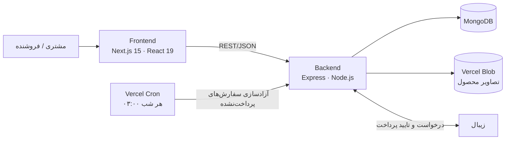

# وندرا (Vendra Shop)

فروشگاه‌ساز فارسی برای فروشگاه‌های لباس و اینستاگرامی: ویترین سریع و سئو‌پذیر، خرید مهمان بدون ثبت‌نام، موجودی دقیق هر سایز و رنگ، پرداخت آنلاین با زیبال و پنل مدیریت کامل برای فروشنده.

> فروشگاه تک‌فروشنده است (هر فروشگاه یک استقرار جدا). پروژه شامل دو بخش مستقل است: `backend` (REST API) و `frontend` (ویترین + پنل ادمین).

---

## امکانات

**برای مشتری**
- خرید مهمان بدون ثبت‌نام (نام، موبایل و آدرس)، سبد خرید ماندگار و کشوی سبد
- انتخاب سایز و رنگ با موجودی لحظه‌ای هر ترکیب؛ ترکیب‌های تمام‌شده غیرفعال نمایش داده می‌شوند
- جست‌وجو، فیلتر (جنسیت، دسته، سایز، رنگ، قیمت) و مرتب‌سازی
- پرداخت آنلاین با درگاه زیبال و صفحه‌های موفق/ناموفق
- پیگیری سفارش با لینک اختصاصی (بدون نیاز به حساب کاربری)
- ریسپانسیو، راست‌چین (RTL)، فونت وزیرمتن، تم روشن و تیره

**برای فروشنده (پنل ادمین)**
- داشبورد (سفارش‌های نیازمند اقدام، محصولات ناموجود/پنهان، آخرین سفارش‌ها)
- مدیریت محصول: تصاویر، تنوع (سایز×رنگ) با تولیدکننده‌ی خودکار، قیمت و تخفیف، انتشار/پیش‌نویس، آدرس صفحه (slug)
- مدیریت سفارش با ماشین‌حالت (در انتظار → در حال پردازش → ارسال‌شده → تحویل‌شده / لغو)
- **تنظیم هزینه‌ی ارسال و حداقل خرید برای ارسال رایگان از داخل پنل**، با پیش‌نمایش آنچه مشتری می‌بیند
- تغییر رمز و «خروج از همه‌ی دستگاه‌ها»

---

## معماری



## ساختار مخزن

```
vendra-shop/
├── backend/                  # REST API (Express + MongoDB)
│   ├── api/index.js          # ورودی serverless (Vercel)
│   ├── src/
│   │   ├── app.js · server.js
│   │   ├── config/           # env، تنظیمات پیش‌فرض، اتصال دیتابیس
│   │   ├── routes/           # مسیرهای عمومی و /admin
│   │   ├── controllers/      # لایه‌ی HTTP (نازک)
│   │   ├── services/         # منطق کسب‌وکار: سفارش، موجودی، پرداخت، زیبال، سبد، تنظیمات
│   │   ├── models/           # Product، Order، Admin، ShopSettings، RateLimit
│   │   ├── validators/       # اعتبارسنجی و پاک‌سازی ورودی
│   │   ├── middlewares/      # احراز هویت ادمین، rate limit، خطا، کش، آپلود
│   │   ├── views/            # شکل خروجی API (جدا از مدل دیتابیس)
│   │   ├── utils/            # slug، هش رمز، توکن، sanitize، شمارنده‌ی ارسال
│   │   └── scripts/          # createAdmin، migrateSlugs
│   ├── test/unit.test.js
│   └── vercel.json           # rewrite + cron
└── frontend/                 # Next.js 15 (App Router)
    ├── app/
    │   ├── page.js           # صفحه‌ی خانه
    │   ├── shop/             # لیست محصولات + فیلتر
    │   ├── product/[slug]/   # جزئیات محصول (SSR/ISR + سئو)
    │   ├── cart · checkout · payment · track
    │   ├── admin/            # پنل ادمین (داشبورد، محصولات، سفارش‌ها، ارسال، حساب)
    │   ├── sitemap.js · robots.js
    │   └── globals.css
    ├── components/           # ProductCard، Gallery، AddToCart، CartDrawer، ...
    │   └── admin/            # ProductForm، VariantGenerator، ImagePicker، ...
    ├── context/              # سبد، نوتیف، هزینه‌ی ارسال، نشست ادمین
    ├── lib/                  # کلاینت API، فرمت‌دهی، slug، ارسال
    └── middleware.js         # ریدایرکت ۳۰۸ لینک‌های قدیمی (id → slug)
```

---

## بک‌اند (`backend/`)

**استک:** Node.js · Express 4 · MongoDB (Mongoose 8) · JWT · Vercel Blob · زیبال

**طراحی لایه‌ای:** `routes → controllers → services → models`، با `validators` برای ورودی و `views` برای خروجی؛ منطق کسب‌وکار فقط در `services` است و به‌صورت واحد تست می‌شود.

### موجودی و سفارش
- موجودی روی **هر ترکیب سایز+رنگ** نگهداری می‌شود.
- رزرو موجودی یک عملیات **atomic** در دیتابیس است (`updateOne` با شرط `stock ≥ تعداد` و `$inc`)، پس دو خریدار هم‌زمان نمی‌توانند آخرین جنس را با هم بخرند (جلوگیری از oversell). رزرو «همه یا هیچ» است: اگر یک آیتم شکست بخورد آنچه رزرو شده برگردانده می‌شود.
- سفارش‌های پرداخت‌نشده با یک **cron شبانه** (و هنگام ثبت سفارش جدید) آزاد می‌شوند و موجودی برمی‌گردد.
- وضعیت سفارش یک **ماشین‌حالت** است؛ فقط انتقال‌های مجاز پذیرفته می‌شود. وضعیت «پرداخت‌شده» را فقط درگاه می‌تواند بدهد؛ ادمین فقط می‌تواند پس از برگشت وجه «بازپرداخت‌شده» ثبت کند.
- قیمت و مجموع **همیشه سمت سرور** حساب می‌شود (قیمت ارسالی از کلاینت نادیده گرفته می‌شود).

### پرداخت (زیبال)
- پس از بازگشت از درگاه، سرور خودش پرداخت را **verify** می‌کند و **مبلغ تاییدشده را با مبلغ سفارش مقایسه** می‌کند؛ عدم تطابق، سفارش را علامت‌گذاری می‌کند (`amount_mismatch`).
- پردازش callback تکراری بی‌خطر است (idempotent): `paid | already_paid | not_paid | amount_mismatch | refund_pending`.

### هزینه‌ی ارسال (قابل تنظیم از پنل)
- مدل `ShopSettings` (یک سند)؛ `PATCH /api/admin/settings` برای ادمین و `GET /api/settings` برای نمایش در ویترین.
- مقدار پیش‌فرض از `.env`؛ تا زمانی که فروشنده چیزی ذخیره نکند همان استفاده می‌شود (بدون نیاز به مهاجرت).
- هزینه‌ی هر سفارش هنگام ثبت در خود سفارش ذخیره می‌شود؛ تغییر نرخ روی سفارش‌های قبلی اثر ندارد. عمداً کش نمی‌شود تا مبلغ نمایش‌داده‌شده و مبلغ ثبت‌شده همیشه یکی باشد.

### slug محصول (آدرس صفحه)
- از عنوان (فارسی/انگلیسی) ساخته و **یکتا** می‌شود (`-2`، `-3`، … و unique index)؛ نیم‌فاصله، ارقام فارسی و حروف عربی (ي/ك) نرمال می‌شوند.
- با ویرایش عنوان تغییر نمی‌کند (لینک‌های منتشرشده نشکنند)؛ ادمین می‌تواند دستی تغییرش بدهد و slug قبلی در `slugHistory` می‌ماند تا ریدایرکت شود.
- `GET /api/products/:idOrSlug` هر دو را می‌پذیرد؛ `GET /api/products/slugs` برای sitemap.
- اسکریپت `migrate-slugs` (با `--dry`) محصولات موجود را slug‌دار می‌کند.

### امنیت
- رمز ادمین با **scrypt** و نمک تصادفی؛ حداقل ۱۲ کاراکتر (حرف+عدد)
- JWT کوتاه‌مدت با `tokenVersion`؛ «خروج از همه‌ی دستگاه‌ها» و تغییر رمز همه‌ی نشست‌ها را باطل می‌کند
- ساخت ادمین فقط از طریق CLI (`npm run create-admin`)؛ ثبت‌نام عمومی وجود ندارد
- قفل موقت حساب پس از چند ورود ناموفق، و **rate limit مبتنی بر دیتابیس** (مناسب serverless که حافظه‌ی مشترک ندارد) روی ورود ادمین، ثبت سفارش، جست‌وجوی سفارش و شروع پرداخت
- لیست IP مجاز اختیاری برای مسیرهای ادمین (`ADMIN_IP_ALLOWLIST`)
- `helmet`، CORS محدود به آدرس فرانت، پاک‌سازی ورودی در برابر NoSQL injection، مقایسه‌ی زمان‌ثابت برای رمزها/توکن‌ها، `Cache-Control: no-store` روی پاسخ‌های ادمین
- آپلود تصویر با محدودیت نوع و حجم (multer) و ذخیره در Vercel Blob

### مسیرهای اصلی
| | |
|---|---|
| `GET /api/products` · `/api/products/:idOrSlug` · `/categories` · `/slugs` | ویترین |
| `GET /api/settings` | هزینه‌ی ارسال برای نمایش |
| `POST /api/cart/quote` | قیمت‌گذاری و بررسی موجودی سبد (سمت سرور) |
| `POST /api/orders` · `POST /api/orders/lookup` · `GET /api/orders/track/:token` · `POST /api/orders/track/:token/cancel` | ثبت سفارش، جست‌وجوی سفارش با موبایل، پیگیری و لغو با لینک اختصاصی |
| `POST /api/payments/zibal/request` · `GET /api/payments/zibal/callback` | شروع پرداخت و بازگشت از زیبال |
| `/api/admin/auth · products · orders · settings` | پنل ادمین (JWT) |
| `GET /api/cron/release-expired` | آزادسازی سفارش‌های منقضی (با `CRON_SECRET`) |

---

## فرانت‌اند (`frontend/`)

**استک:** Next.js 15 (App Router) · React 19 · CSS خالص (بدون کتابخانه‌ی UI) · وزیرمتن

### سئو و سرعت
- صفحه‌ی محصول سمت سرور رندر می‌شود (ISR) با `generateMetadata`: `canonical`، **Open Graph** و Twitter card (برای پیش‌نمایش لینک در اینستاگرام/تلگرام/واتساپ)، و **JSON-LD** (`Product` با قیمت و موجودی + `BreadcrumbList`)
- `sitemap.xml` پویا از همه‌ی محصولات منتشرشده، `robots.txt`
- `middleware.js`: لینک قدیمی با id با **ریدایرکت دائمی ۳۰۸** به slug می‌رود
- `next/image` با `sizes` مناسب، تصویر دوم محصول با hover، اسکلت بارگذاری (skeleton)

### رابط کاربری
- کارت محصول طراحی‌شده: نوار تخفیف آویزان، برچسب «جدید»، نمایش سایزها با hover (سایز تمام‌شده خط می‌خورد)، حباب رنگ‌ها
- سبد ماندگار (localStorage) با همگام‌سازی قیمت و موجودی از سرور؛ نوار پیشرفت «تا ارسال رایگان»
- تم روشن/تیره، RTL کامل، دسترس‌پذیری پایه (`aria`، focus، `prefers-reduced-motion`)

### پنل ادمین
- نشست JWT با هشدار پایان اعتبار و ورود مجدد بدون از دست رفتن فرم
- فرم محصول: انتخاب و مرتب‌سازی تصاویر، **تولیدکننده‌ی تنوع** (ترکیب سایز×رنگ)، پیش‌نمایش قیمت و درصد تخفیف، فیلد slug با پیش‌نمایش آدرس
- صفحه‌ی «هزینه‌ی ارسال» و نمایش نرخ فعلی در داشبورد

---

## اجرا (محلی)

نیازمندی‌ها: Node.js ≥ 18، MongoDB

```bash
# بک‌اند
cd backend
cp .env.example .env          # مقدارها را پر کنید
npm install
npm run create-admin -- myadmin    # رمز مخفی پرسیده می‌شود
npm run dev                        # http://localhost:5000

# فرانت‌اند (ترمینال دیگر)
cd frontend
cp .env.example .env.local
npm install
npm run dev                        # http://localhost:3000
```

**متغیرهای مهم**

| بک‌اند | توضیح |
|---|---|
| `MONGODB_URI` · `JWT_SECRET` | دیتابیس و کلید امضای JWT (در production حداقل ۳۲ کاراکتر) |
| `CORS_ORIGIN` · `FRONT_URL` | آدرس فرانت |
| `ZIBAL_MERCHANT` · `ZIBAL_CALLBACK_URL` | درگاه پرداخت |
| `CRON_SECRET` · `BLOB_READ_WRITE_TOKEN` | cron و ذخیره‌ی تصاویر |
| `SHIPPING_PRICE` · `FREE_SHIPPING_THRESHOLD` | فقط پیش‌فرض؛ مقدار واقعی از پنل |

| فرانت‌اند | توضیح |
|---|---|
| `NEXT_PUBLIC_API_URL` | آدرس بک‌اند |
| `NEXT_PUBLIC_SITE_URL` | آدرس سایت (sitemap و canonical) |

**تست:** `cd backend && npm test` (تست‌های واحد با `node:test`: هش و سیاست رمز، sanitize، اعتبارسنجی سفارش/محصول/تنوع، توکن‌ها، slug، هزینه‌ی ارسال و تنظیمات). منطق موجودی و پرداخت به دیتابیس نیاز دارد و با تست واحد پوشش داده نشده است.

## استقرار
۱. بک‌اند را روی Vercel (Root Directory: `backend`) با متغیرهای بالا بالا بیاورید؛ `vercel.json` rewrite و cron را تنظیم می‌کند.
۲. روی دیتابیس واقعی: `npm run migrate-slugs -- --dry` و سپس بدون `--dry`، و `npm run create-admin -- <نام>`.
۳. فرانت را روی Vercel (Root Directory: `frontend`) با `NEXT_PUBLIC_API_URL` بالا بیاورید.
۴. از `/admin/login` وارد شوید و در `/admin/shipping` هزینه‌ی ارسال را تنظیم کنید.

---

## مسائلی که این پروژه حل می‌کند

| مسئله | راه‌حل |
|---|---|
| فروش بیش از موجودی وقتی دو نفر هم‌زمان می‌خرند | کاهش atomic موجودی هر variant با شرط `stock ≥ n` و رزرو همه‌یا‌هیچ |
| سفارش‌های رهاشده موجودی را قفل می‌کنند | cron شبانه + آزادسازی هنگام سفارش جدید |
| دستکاری مبلغ یا پرداخت ناقص | قیمت‌گذاری سمت سرور و تطبیق مبلغ تاییدشده‌ی زیبال با سفارش |
| ریت‌لیمیت در محیط serverless (بدون حافظه‌ی مشترک) | شمارنده‌ی مبتنی بر MongoDB با TTL |
| نرخ ارسال که هر روز عوض می‌شود | تنظیمات قابل ویرایش در پنل، ذخیره‌ی نرخ در هر سفارش |
| آدرس محصول با id، غیر سئو‌پذیر و تکراری | slug یکتا، تاریخچه‌ی slug، ریدایرکت ۳۰۸، sitemap و JSON-LD |
| پیش‌نمایش ضعیف لینک در اینستاگرام | Open Graph و عکس شاخص در هر صفحه‌ی محصول |
